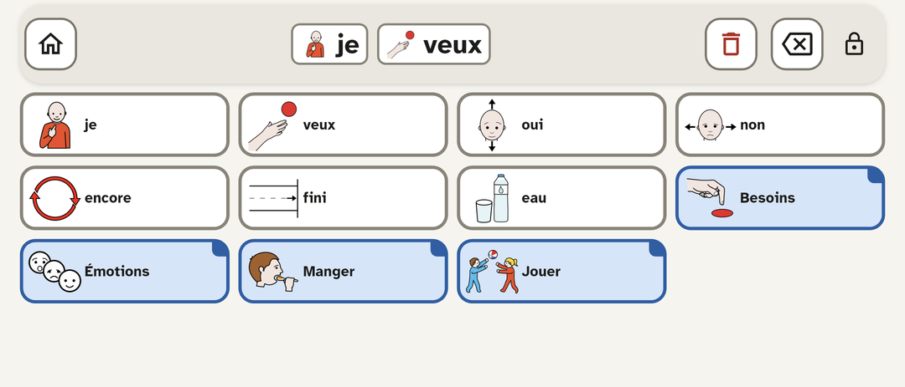
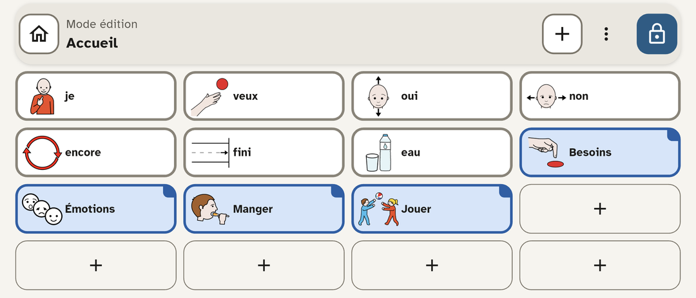

# Glyphe

Glyphe est une application de communication améliorée et alternative (CAA) par pictogrammes : on compose une phrase en touchant des cases, puis l'appli la lit à voix haute. Elle est gratuite et fonctionne entièrement hors ligne.



*Écran de communication : chaque case touchée s'ajoute à la phrase, qu'un appui lit à voix haute. Les cases-dossiers, en bleu, ouvrent une autre page.*



*Mode édition, déverrouillé par l'aidant (appui long sur le cadenas) : ajouter, modifier ou échanger les cases.*

## Prérequis

- Flutter (canal stable) : `git clone --depth 1 -b stable https://github.com/flutter/flutter.git ~/development/flutter`, puis ajouter `~/development/flutter/bin` au `PATH`.
- SDK Android (pour construire l'APK uniquement) :
  1. Télécharger `commandlinetools-linux-*_latest.zip` (page « Command line tools only » de developer.android.com/studio) et le décompresser dans `~/Android/Sdk/cmdline-tools/latest/`.
  2. `export ANDROID_HOME=$HOME/Android/Sdk`
  3. `export PATH=$PATH:$ANDROID_HOME/cmdline-tools/latest/bin:$ANDROID_HOME/platform-tools`
  4. `android --sdk=$HOME/Android/Sdk sdk install platform-tools "platforms;android-35" "build-tools;35.0.0"`
  5. `flutter config --android-sdk ~/Android/Sdk`, puis `flutter doctor --android-licenses`.
- Java 21.
- Vérification : `flutter doctor`.

## Installation

```
flutter pub get
```

## Tests et lint

```
flutter --no-color test --reporter compact
flutter analyze --no-pub && dart format --output=none --set-exit-if-changed lib test tool
```

## Construire et installer l'APK

```
bash tool/verifier_apk.sh
adb install build/app/outputs/flutter-apk/app-release.apk
```

Le script construit l'APK et vérifie qu'il ne demande pas l'accès à Internet et qu'il est signé avec la clé dédiée. N'installer que l'APK qu'il a validé.

## Signature de l'APK

Une mise à jour n'est acceptée que si l'APK est signé avec la même clé : il faut une clé dédiée, conservée durablement.

1. Créer la clé, hors du dépôt :

```
keytool -genkeypair -v -keystore ~/glyphe-release.jks -keyalg RSA -keysize 2048 -validity 10000 -alias glyphe
```

2. Créer `android/key.properties` (ignoré par git) :

```
storePassword=<mot de passe>
keyPassword=<mot de passe>
keyAlias=glyphe
storeFile=/home/<vous>/glyphe-release.jks
```

3. Sauvegarder le keystore et son mot de passe hors de la machine : sans eux, plus aucune mise à jour n'est possible.

Passage unique depuis la 1.7.0 ou antérieure : exporter les grilles (Réglages > Sauvegarde > Exporter) et enregistrer le fichier hors de l'appli, désinstaller l'appli, installer le nouvel APK, importer la sauvegarde, puis redéfinir le code.

## Régénérer la banque ARASAAC

La banque de pictogrammes embarquée (`assets/arasaac/`) est produite à partir de l'API ARASAAC (réseau nécessaire) :

```
dart run tool/generer_banque_arasaac.dart
```

## Fonctionnement

- **Affichage** : en paysage seulement. Les grilles ont 4 colonnes et 3 lignes par défaut ; la taille se change par « Taille de la grille » dans le menu « Plus » du mode édition.
- **Communication** : la barre du haut contient « Accueil », la phrase composée (un appui la lit, un nouvel appui arrête la lecture), « Corbeille » (efface la phrase), « Effacer » (le dernier mot) et le cadenas. On change de page par les cases-dossiers et on revient par la case « Retour ».
- **Cases** : chaque case a une catégorie grammaticale (personne, action, objet, description, social, question, petit mot) qui détermine sa couleur. Une case est de type Mot, Dossier ou Retour.
- **Édition** : la barre d'édition donne accès à « Ajouter une case », au menu « Plus » (code, grilles, taille de la grille, réglages, À propos) et à « Terminer ». En édition d'une case : Supprimer, Échanger avec l'emplacement…, Ouvrir (dossier), Enregistrer ; on touche l'aperçu de l'image pour la choisir.
- **Thème** : clair ou sombre, selon le réglage du système.

## Usage

- **Déverrouiller l'édition** : maintenir le cadenas appuyé 3 secondes. Si un code est défini, il est demandé.
- **Code** : le code de déverrouillage (4 chiffres) se définit, se modifie ou se supprime dans les réglages.
- **Code oublié** : sur l'écran de saisie du code, « Code oublié » affiche une phrase à recopier. Si la recopie est correcte, le code est supprimé et le mode édition s'ouvre.
- **Export / import** : dans les réglages, section « Sauvegarde ». L'import remplace toutes les données actuelles après confirmation.

## Licence et attribution

Glyphe est gratuit et réservé à un usage non commercial.

Les symboles pictographiques utilisés sont la propriété du Gouvernement d'Aragon et ont été créés par Sergio Palao pour ARASAAC (http://www.arasaac.org), qui les distribue sous licence Creative Commons BY-NC-SA.

La police Atkinson Hyperlegible (Braille Institute) est distribuée sous licence SIL Open Font License 1.1 (`assets/fonts/OFL.txt`).
